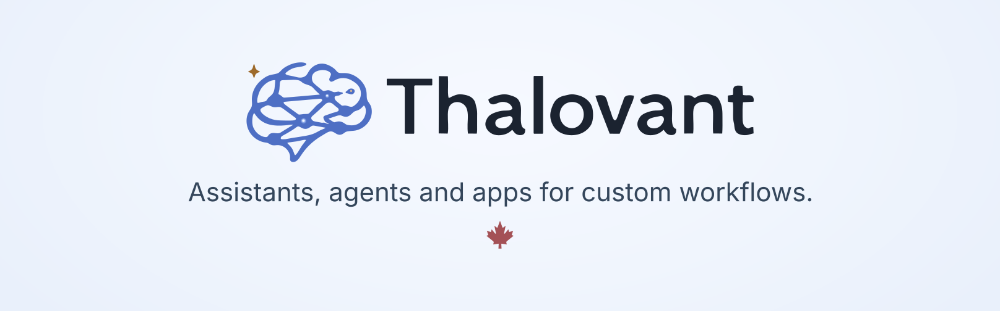

<!--
GitHub organization profile: shown at https://github.com/thalovant.
Last Edit: Codex - 2026-11-11 - Motive: Use the latest approved social banner with the full tagline and maple leaf.
-->

  <picture>
    <source media="(prefers-color-scheme: dark)" srcset="assets/thalovant-banner-dark.png">
    <source media="(prefers-color-scheme: light)" srcset="assets/thalovant-banner-light.png">
    
  </picture>

  <a href="https://thalovant.com/"><strong>Website</strong></a>
  &nbsp;·&nbsp;
  <a href="https://dash.thalovant.com/showroom"><strong>Try Daily Desk</strong></a>
  &nbsp;·&nbsp;
  <a href="https://docs.thalovant.com/"><strong>Docs</strong></a>
  &nbsp;·&nbsp;
  <a href="https://www.youtube.com/@thalovant"><strong>YouTube</strong></a>
  &nbsp;·&nbsp;
  <a href="https://discord.gg/ZRVMARguxC"><strong>Discord</strong></a>

Thalovant connects assistants, AI agents, apps and devices to hubs that run
skills and return text, speech or structured responses. Use voice, the web and
APIs, with skills, clients and access rules managed in your workspace.

## Start here

- **Try it:** [Ask Daily Desk](https://dash.thalovant.com/showroom) in your
  browser, without an account. This preview keeps no chat memory.
- **Find a hub:** [Explore public hubs](https://dash.thalovant.com/explore)
  and their example questions.
- **Build something:** [Make your first request](https://docs.thalovant.com/developers/)
  or [choose an SDK](https://docs.thalovant.com/developers/sdks/).
- **Watch demos:** [Visit the Thalovant YouTube channel](https://www.youtube.com/@thalovant)
  for the OpenVoiceOS, HiveMind and Home Assistant video archive.

## Build with Thalovant

| I want to | Guide and source |
| --- | --- |
| Connect an app or service | [SDK guide](https://docs.thalovant.com/developers/sdks/) and the language repositories below |
| Connect an AI agent | [MCP guide](https://docs.thalovant.com/developers/mcp/) · [thalovant-mcp](https://github.com/thalovant/thalovant-mcp) |
| Connect an embedded device to a hub | [Embedded C guide](https://docs.thalovant.com/developers/sdks/embedded-c/) · [thalovant-embedded-c](https://github.com/thalovant/thalovant-embedded-c); your device supplies the transport, TLS and protected storage |
| Use Home Assistant | [Setup guide](https://docs.thalovant.com/manage/home-assistant/) · [ha-thalovant](https://github.com/thalovant/ha-thalovant), installed through HACS |
| Write a skill | [Skill guide](https://docs.thalovant.com/developers/writing-a-skill/) · [thalovant-skillkit](https://github.com/thalovant/thalovant-skillkit) |
| Connect a phone or computer | [Install Thalovant Voice](https://docs.thalovant.com/manage/install-thalovant-voice/) · [Downloads](https://github.com/thalovant/thalovant-downloads) |
| Add language support | [thalovant-languages](https://github.com/thalovant/thalovant-languages) |

**SDK repositories:**
[Python](https://github.com/thalovant/thalovant-python-sdk) ·
[Node.js / TypeScript](https://github.com/thalovant/thalovant-node-sdk) ·
[Go](https://github.com/thalovant/thalovant-go-sdk) ·
[Rust](https://github.com/thalovant/thalovant-rust-sdk) ·
[Swift](https://github.com/thalovant/thalovant-swift-sdk) ·
[Kotlin](https://github.com/thalovant/thalovant-kotlin-sdk) ·
[.NET](https://github.com/thalovant/thalovant-dotnet-sdk).

## Open source and contributions

This organization hosts our public SDKs, integrations, libraries and forks.
Thalovant builds on [OpenVoiceOS](https://github.com/OpenVoiceOS) and
[HiveMind](https://github.com/JarbasHiveMind). Each repository states its own
license and contribution process; upstream credits and licenses stay with the
projects they belong to.

Read the repository's contribution instructions first, or use our
[contribution guide](https://github.com/thalovant/.github/blob/main/CONTRIBUTING.md)
when it has none.

## Help and security

For product help, start with the [support guide](https://docs.thalovant.com/account/get-support/)
or join [Discord](https://discord.gg/ZRVMARguxC). Report software bugs in the
relevant repository's issue tracker.

Report suspected vulnerabilities privately to
[hello@thalovant.com](mailto:hello@thalovant.com), following our
[security policy](https://github.com/thalovant/.github/blob/main/SECURITY.md).
Please do not include credentials or customer data in public issues.
