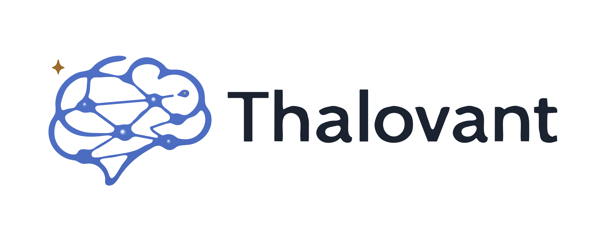

<!-- Last Edit: Codex - 2026-11-07 - Motive: Document the shared theme-aware header for repository READMEs. -->

# Thalovant profile branding

These assets come from the approved Thalovant press-logo set. Use the blue brain
and amber star with its supplied geometry and outlined wordmark.

- `thalovant-logo-light.png`: the standard horizontal lockup for light surfaces.
- `thalovant-logo-dark.png`: the inverse horizontal lockup for dark surfaces.
- `thalovant-mark-light.png`: the full mark for light surfaces, above 48 pixels.
- `thalovant-mark-dark.png`: the full mark for dark surfaces, above 48 pixels.
- `favicon.ico`: the supplied light-surface artwork at native 16, 32 and 48 pixel sizes, with transparent square padding.

For small interface icons, use the press pack's dedicated 16/24/32/48 pixel
artwork. For account profiles, use its circular navy avatar. Do not recreate the
mark, recolor it, stretch it, or use the large mark as a tiny favicon.

## Repository README header

Use this header in the primary README of first-party Thalovant projects. Keep
the repository's own title, badges and documentation below it. The shared public
assets keep the artwork consistent without copying it into every repository.
The light fallback also works in readers that do not support theme selection.

```html
<p align="center">
  <picture>
    <source media="(prefers-color-scheme: dark)" srcset="https://raw.githubusercontent.com/thalovant/.github/main/profile/assets/thalovant-logo-dark.png">
    <source media="(prefers-color-scheme: light)" srcset="https://raw.githubusercontent.com/thalovant/.github/main/profile/assets/thalovant-logo-light.png">
    
  </picture>
</p>
```

Preserve upstream project branding in forks and third-party acknowledgments.
